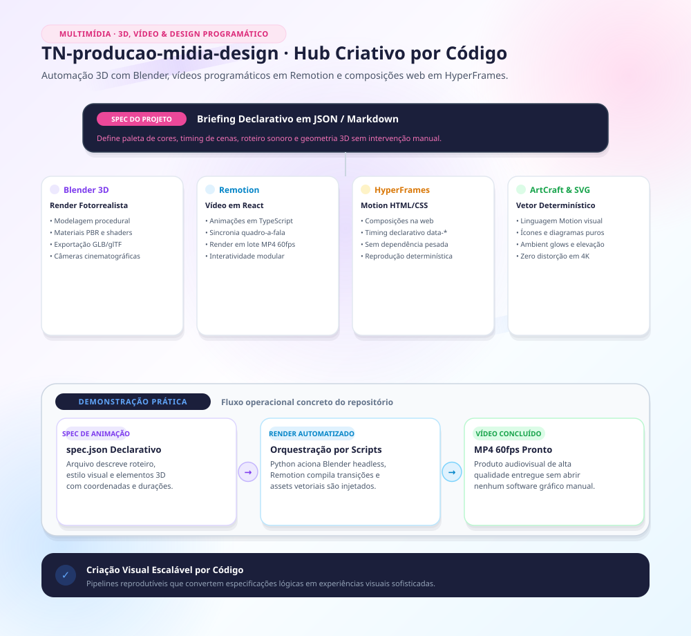

Feito por cópia de repo privado producao-midia-design na versão 30bcca5 de TN em 11/2026.

---

# Produção de mídias e design

Repositório de trabalho para vídeo, imagem, voz/personagem (Google Flow), 3D (Blender) e design
gráfico com os apps ArtCraft. **Só ferramenta e método — nenhum dado de caso entra aqui.**

## Regras que valem para tudo
- **Emblema/brasão nunca é redesenhado por IA.** A IA gera fundo, luz e movimento; o emblema
  original entra por composição local. → `docs/regra-emblema-nunca-redesenhado.md`
- **Sigilo:** prompt enviado ao Flow sai da máquina. Só texto genérico; nunca arquivo, print ou
  figura de caso. Os apps ArtCraft e o Blender rodam locais.
- Conferir todo vídeo gerado por folha de contato antes de entregar (o Veo/Omni foge do prompt).

## Mapa
| Frente | Ferramentas | Método | Código |
|---|---|---|---|
| Imagem / retoque | PhotoCraft (MCP), PIL | — | — |
| Vetor / logo | VectorCraft (MCP) | — | — |
| Vídeo / montagem | FilmCraft, EffectCraft (MCP), ffmpeg | `docs/narracao-por-cenas.md` | `scripts/video/` |
| Personagem e voz | Google Flow (Veo 3.1 / Omni + voz salva) pelo navegador interno | `docs/google-flow.md`, `docs/padrao-personagem-e-voz.md` | `scripts/video/aplicar_emblema.py` |
| 3D de emblemas | Blender 4.5 LTS (MCP `blender`, escopo do usuário) | `docs/3d-*.md` | `scripts/3d/` |
| Foto / revelação RAW | LightCraft (MCP) | — | — |
| PDF | PdfCraft (MCP) | — | — |
| Diagramação / impresso | DesignCraft (MCP) | — | — |
| Slides com mídia | python-pptx / pptxgenjs | `docs/deck-*.md` | — |

## Apps ArtCraft por MCP
Instalados em `C:\Apps\<app>-<versão>-windows-x64-portable\` (zip oficial `storytold/<app>`,
SHA-256 e assinatura Authenticode conferidos). O `.mcp.json` sobe cada `<app>-cli mcp` em modo
headless (sem a janela aberta). Na primeira abertura do Claude Code nesta pasta, aprovar os servidores.

| Servidor | Acesso a arquivos |
|---|---|
| photocraft, vectorcraft, effectcraft | lê em `trabalho/`, grava **só** em `trabalho/saida/` (testado: caminho fora é recusado) |
| pdfcraft | confinado a `trabalho/` |
| lightcraft | biblioteca persistente em `trabalho/lightcraft-biblioteca/` |
| filmcraft, designcraft | **sem confinamento** — o CLI não oferece a opção; vigiar o que o agente grava |

Para pilotar o app **aberto** (ver na tela o que o agente faz): iniciar o app com `--control <porta>`
e trocar o argumento do servidor para `--bridge`/`--connect` (ver `<app>-cli --help`).

⚠️ **Atualizar um app muda o nome da pasta** (versão no caminho): ajustar o `.mcp.json` junto.

## 3D: pacotes pesados ficam fora do repo
Os scripts em `scripts/3d/` apontam para os pacotes originais (blend, texturas, renders, GLB):
- `%USERPROFILE%\Documents\Emblema-INSTITUICAO-Padrao\` (mestre v7) — `docs/3d-emblema-instituicao-LEIA-ME.md`
- `%USERPROFILE%\Documents\Emblemas-Instituicoes-3D\` — `docs/3d-emblemas-instituicoes-LEIA-ME.md`

## Pastas
- `trabalho/entrada`, `trabalho/saida` — área de trabalho dos MCPs (fora do git)
- `docs/` — métodos medidos (cópias das notas da vault de 13/10/2026; a vault segue sendo a fonte)
